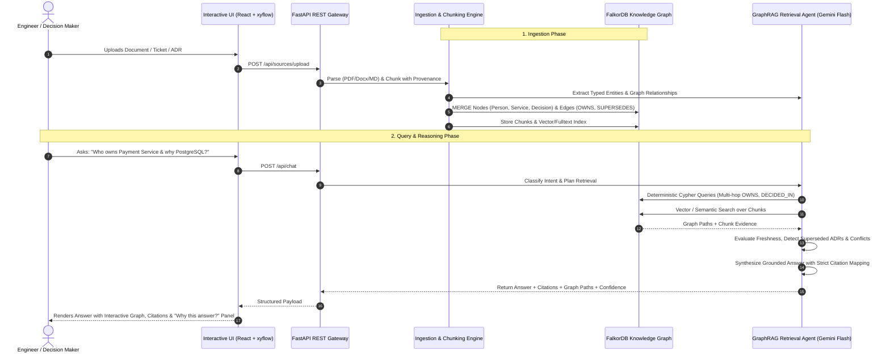

# Company Brain — Graph-Native Organizational Intelligence

[](https://www.wemakedevs.org/hackathons/falkordb)
[](https://www.wemakedevs.org/hackathons/falkordb#tracks)
[](https://www.wemakedevs.org/hackathons/falkordb#prizes)
[](https://fastapi.tiangolo.com)
[](https://vitejs.dev)
[](https://ai.google.dev)

> Built for [**Graph Hacks: Context for AI Agents**](https://www.wemakedevs.org/hackathons/falkordb) (October 15–18, 2026) organized by **WeMakeDevs** and **FalkorDB**.  
> Primary Track: **Track 03 — Company Brain** ($20,000 Total Prize Pool).  
> Also demonstrating cross-track support for **Track 01** (*Agents That Act on Connected Data*) and **Track 02** (*Agent Memory and Coordination*).

---

## System Architecture & End-to-End Project Flow

The **Company Brain** transforms unstructured corporate knowledge (documents, chats, tickets, architecture decisions) into a deterministic, verifiable graph-native intelligence engine powered by **FalkorDB**, **Gemini Flash LLM**, and an interactive **React Flow UI**.


### End-to-End Flow Walkthrough



---

## 1. Hackathon Alignment: Track 03 — Company Brain

As specified in the [Graph Hacks official challenge](https://www.wemakedevs.org/hackathons/falkordb):

> *"Agents are only as good as the context they work with. Give yours a graph: connected data it can reason over, a memory it keeps between sessions, and a clear picture of how things relate. Build an agent that makes decisions you can trace."*

### How Company Brain Solves the Hackathon Brief
- **Knowledge from docs, tickets, and chats in one graph**: Ingestion pipeline unifies PDFs, Word docs, Markdown ADRs, and Slack/Jira extracts into a unified FalkorDB graph.
- **Who owns what, and who knows what**: Explicitly separates formal ownership (`[:OWNS]`) from inferred domain expertise (`[:KNOWS_ABOUT]`).
- **Tracing decisions back to their source**: Historical ADRs are chained via `[:SUPERSEDES]` relationships, providing a permanent historical audit trail.
- **Keeping knowledge current as things change**: Detects changed source files and updates graph records idempotently via `POST /api/sync`.
- **Answers with clear sources**: 100% of claims feature verbatim chunk citations with page numbers and offsets.

---

## 2. Non-Negotiable Core Tenets & Hackathon Rules

1. **FalkorDB is Central, Not Decorative (Hackathon Rule 3)**:
   > *"The graph has to do real work. A visualisation drawn on top of ordinary storage does not qualify: if the product still works once FalkorDB is taken out, the graph is decoration rather than the thing the product runs on."*  
   - Graph queries, multi-hop relationship traversals, and Cypher path finding directly power the application's reasoning. Removing FalkorDB breaks the system.
2. **100% Traceable Evidence & Citations**: Every factual statement is backed by verified source metadata (`source_id`, `chunk_id`, `excerpt`, `timestamp`, `uri`).
3. **Zero Hallucination / Honest Abstention**: The model never fabricates a person, date, owner, or relationship. If evidence is missing or ambiguous, it explicitly abstains.
4. **Temporal Integrity & Decision Lineage**: Old decisions are never erased; they are linked via `[:SUPERSEDES]` relationships to preserve historical context and auditability.
5. **Contradiction Transparency**: Contradictory sources are surfaced as alerts rather than silently suppressed or averaged out.
6. **Authorized Synthetic Data Only (Hackathon Rule 6)**: Built against public, synthetic corporate data (**Northstar Systems**). No private or restricted data.
7. **AI Assistant Disclosure (Hackathon Rule 11 & 12)**: Developed using Google Antigravity paired with Gemini Flash models. The architecture, Cypher queries, and graph schema are fully understood, verified, and documented.

---

## 3. Technology Stack

| Layer | Component | Selection | Rationale |
| :--- | :--- | :--- | :--- |
| **Frontend** | Framework | React 18 + Vite + TypeScript | High-performance, fully typed, instant HMR |
| | UI & Styling | Tailwind CSS + Lucide Icons + shadcn/ui | Clean enterprise design, accessible tokens |
| | Graph Visualizer | `@xyflow/react` (React Flow) | Interactive canvas, custom node cards, minimap, zoom/pan |
| **Backend** | Framework | Python 3.12 + FastAPI + Pydantic v2 | High-throughput async API, strict schema validation |
| | Web Server | Uvicorn (ASGI) | Standard production ASGI runner |
| **Graph & Storage** | Primary Graph DB | **FalkorDB** (Dockerized `latest`) | Ultra-fast Redis-based graph database, Cypher execution |
| | SDK / Querying | `falkordb-py` + FalkorDB GraphRAG SDK | Native connection pooling, parameterized Cypher |
| **AI / LLM** | Foundation Model | Gemini 1.5 Flash / Gemini 2.5 Flash | High speed, massive context, precise structured JSON outputs |
| | Embeddings | Gemini Text Embedding / FalkorDB vector index | Fast semantic chunk retrieval |
| **Parsing** | Document Extractors | PyMuPDF (PDF), python-docx (DOCX), Markdown | Reliable multi-format ingestion preserving offsets |
| **DevOps** | Containerization | Docker + Docker Compose | One-command full-stack reproducible deployment |

---

## 4. Repository Structure

```text
company-brain/
├── assets/
│   └── system_architecture_flow.jpg           # End-to-end architecture & flow diagram
├── docker-compose.yml                         # Orchestrates FalkorDB, Backend, and Frontend
├── .env.example                               # Environment template with documented defaults
├── .gitignore                                 # Git ignore rules for Python, Node, OS, & secrets
├── README.md                                  # Master build guide and system architecture
├── backend/
│   ├── pyproject.toml / requirements.txt      # Python dependencies
│   ├── app/
│   │   ├── main.py                            # FastAPI application entrypoint & CORS
│   │   ├── core/
│   │   │   ├── config.py                      # Pydantic BaseSettings with env validation
│   │   │   └── security.py                    # Input sanitization & safety bounds
│   │   ├── api/
│   │   │   ├── router.py                      # Master API route registry
│   │   │   └── endpoints/                     # Health, Sources, Chat, Graph, Decisions, Impact
│   │   ├── models/                            # Pydantic models for Entities, Schemas, Requests
│   │   ├── services/                          # Business logic services
│   │   ├── graph/                             # FalkorDB client, Cypher query templates, schema
│   │   ├── ingestion/                         # Multi-format parsers, chunker, LLM extractors
│   │   ├── retrieval/                         # Intent classification, GraphRAG, answer synthesis
│   │   └── tests/                             # Unit, graph integration, and API test suites
├── frontend/
│   ├── package.json                           # React & Vite dependencies
│   ├── vite.config.ts                         # Vite configuration & proxy settings
│   ├── src/
│   │   ├── App.tsx                            # Root application & routing shell
│   │   ├── components/                        # Navigation, Chat, GraphExplorer, Sources, Modals
│   │   ├── api/                               # Strongly-typed API client
│   │   └── types/                             # TypeScript interfaces matching backend models
├── data/
│   ├── README.md                              # Synthetic Northstar Systems corpus guide
│   └── sample/                                # MD, PDF, DOCX, JSON fixtures
├── docs/
│   ├── ARCHITECTURE.md                        # Detailed architecture & component breakdown
│   ├── GRAPH_SCHEMA.md                        # Cypher schema, node/edge models, index rules
│   ├── API_CONTRACT.md                        # Complete REST API schemas & error models
│   ├── TECH_DECISIONS.md                      # ADR log of all architectural choices
│   └── DEMO_SCRIPT.md                         # 3-5 minute step-by-step hackathon script
└── modules/
    ├── README_00_MASTER.md                    # Master execution checklist & handoff matrix
    ├── README_01_FOUNDATION.md                # Module 01: Repository Foundation & Runtime
    ├── README_02_GRAPH_SCHEMA.md              # Module 02: FalkorDB Graph Schema & Cypher Service
    ├── README_03_INGESTION.md                 # Module 03: Source Ingestion & Provenance Chunker
    ├── README_04_RETRIEVAL_AGENT.md           # Module 04: GraphRAG Agent & Multi-Hop Reasoning
    ├── README_05_EVIDENCE_FRESHNESS.md        # Module 05: Evidence, Decision History & Freshness
    ├── README_06_FRONTEND.md                  # Module 06: React UI & Interactive Graph Explorer
    ├── README_07_API_INTEGRATION.md           # Module 07: End-to-End API Integration
    ├── README_08_TESTING_SECURITY.md          # Module 08: Quality, Benchmarks & Security
    └── README_09_DEPLOYMENT_DEMO.md           # Module 09: Docker Deployment & Hackathon Demo
```

---

## 5. Modules Roadmap & Direct Links

| Module | Focus Area | Key Deliverables | Guide Link |
| :---: | :--- | :--- | :---: |
| **00** | **Master Orchestration** | Execution protocol, hand-off matrix, verification protocols | [README_00_MASTER.md](modules/README_00_MASTER.md) |
| **01** | **Foundation & Runtime** | Monorepo layout, Docker Compose, `.env`, FastAPI health check | [README_01_FOUNDATION.md](modules/README_01_FOUNDATION.md) |
| **02** | **Graph Schema & Service** | 11 Node types, 13 Edge types, parameterized Cypher service, indexes | [README_02_GRAPH_SCHEMA.md](modules/README_02_GRAPH_SCHEMA.md) |
| **03** | **Ingestion & Provenance** | PyMuPDF/DOCX/MD parsers, chunking with offsets, LLM extraction | [README_03_INGESTION.md](modules/README_03_INGESTION.md) |
| **04** | **Retrieval Agent & GraphRAG** | Intent classifier, dual-path graph + vector retrieval, citations | [README_04_RETRIEVAL_AGENT.md](modules/README_04_RETRIEVAL_AGENT.md) |
| **05** | **Evidence & Freshness** | Superseded decisions, conflict detector, inferred expertise, impact | [README_05_EVIDENCE_FRESHNESS.md](modules/README_05_EVIDENCE_FRESHNESS.md) |
| **06** | **Frontend & Graph Explorer** | React 18, `@xyflow/react` explorer, chat with citations, timeline | [README_06_FRONTEND.md](modules/README_06_FRONTEND.md) |
| **07** | **API Contract & Integration**| 10 REST endpoints, OpenAPI docs, typed client, CORS & auth config | [README_07_API_INTEGRATION.md](modules/README_07_API_INTEGRATION.md) |
| **08** | **Testing & Security** | 15-question benchmark suite, mock-free test adapter, prompt safety | [README_08_TESTING_SECURITY.md](modules/README_08_TESTING_SECURITY.md) |
| **09** | **Deployment & Demo** | Docker deployment, 3-5 min live demo script, submission pack | [README_09_DEPLOYMENT_DEMO.md](modules/README_09_DEPLOYMENT_DEMO.md) |

---

## 6. Quickstart Commands

```bash
# 1. Clone repository
git clone https://github.com/Siddhesh-45/GraphHack.git
cd GraphHack

# 2. Configure Environment
cp .env.example .env
# Set GOOGLE_API_KEY=your_gemini_api_key

# 3. Launch with Docker Compose
docker compose up --build -d

# 4. Access Services
# Frontend: http://localhost:5173
# API Docs: http://localhost:8000/docs
# Health:   http://localhost:8000/api/health
```
