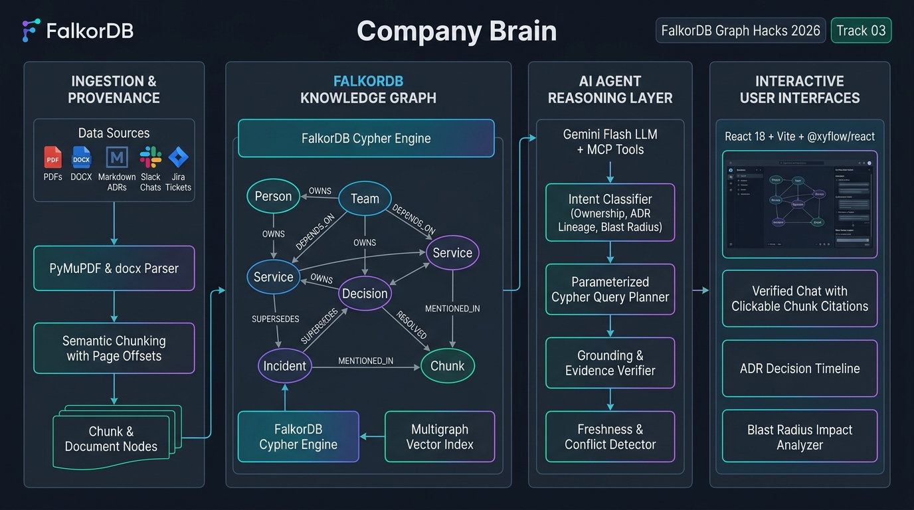
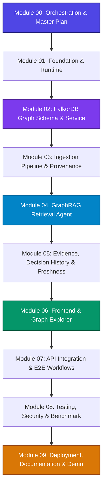

# Module 00 — Master Orchestration & Execution Protocol

## Purpose
This document is the binding architectural and operational protocol for the development of **Company Brain**. It defines the execution sequence, artifact hand-off boundaries, quality gates, and completion verification standards for all implementation modules.

---

## 1. System Architecture & Project Flow



### Module Dependency & Execution Graph



---

## 2. Artifact Hand-Off Matrix

Every module produces concrete, typed assets consumed by downstream modules. Do not proceed to a downstream module until all upstream prerequisites are built and verified.

| Module | Produces (Outputs) | Consumed By | Key Interface / Asset |
| :--- | :--- | :--- | :--- |
| **01 Foundation** | Monorepo layout, Docker Compose, `.env`, FastAPI base, Vite shell | Modules 02-09 | `docker-compose.yml`, `GET /api/health`, `backend/app/main.py` |
| **02 Graph Schema** | FalkorDB client, 11 node models, 13 relationship models, parameterized Cypher service | Modules 03, 04, 05, 07 | `app/graph/connection.py`, `app/graph/queries.py`, `app/models/graph.py` |
| **03 Ingestion** | Multi-format parsers (PDF, DOCX, MD), chunker with offsets, LLM entity extractors | Modules 04, 05, 07 | `app/ingestion/pipeline.py`, `POST /api/sources/upload`, `Chunk` & `Document` nodes |
| **04 Retrieval Agent** | Intent classifier, dual-path Cypher/Vector retrieval, Gemini synthesis, citation engine | Modules 05, 06, 07 | `app/retrieval/agent.py`, `POST /api/chat`, `ChatResponse` model |
| **05 Evidence & Freshness**| Superseded decision tracker, conflict alert engine, inferred expertise scorer, impact analyzer | Modules 06, 07 | `app/services/freshness.py`, `app/services/impact.py`, `GET /api/projects/{id}/impact` |
| **06 Frontend** | React UI with Chat, `@xyflow/react` Graph Explorer, Sources table, Decision Timeline | Module 07 | `frontend/src/components/*`, typed API client |
| **07 API Integration** | End-to-end integration of 10 REST endpoints, CORS, error handling, contract docs | Module 08 | `docs/API_CONTRACT.md`, `app/api/router.py` |
| **08 Testing & Security** | 15-question benchmark suite, mock-free deterministic test adapter, security audit | Module 09 | `backend/app/tests/*`, benchmark verification script |
| **09 Deployment & Demo** | Docker deployment, 3-5 min live hackathon demo script, submission documentation | Hackathon Submission | `docs/DEMO_SCRIPT.md`, submission video recording |

---

## 3. Standard Operating Procedure (SOP) per Module

When implementing or extending any module, execute in this strict five-step order:

### Step 1: Pre-Implementation Inspection
1. Read the target module README and its upstream dependencies.
2. Inspect the current workspace code, types, and existing tests.
3. Validate that environment variables and required Docker services (FalkorDB) are active.

### Step 2: Incremental Implementation
1. Implement the minimal vertical slice required by the module.
2. Reuse existing Pydantic models, schema definitions, and utilities.
3. Maintain clean separation between API routes, business logic services, and Cypher queries.
4. Enforce strict parameterization on all Cypher statements.

### Step 3: Verification & Testing
1. Run unit and integration tests specifically targeting the new functionality.
2. If tests fail, diagnose root cause and fix immediately before continuing.
3. Verify deterministic test adapters work in environments without live API keys.

### Step 4: Documentation & Contracts
1. Update `docs/TECH_DECISIONS.md` whenever non-obvious architecture decisions are made.
2. Keep `docs/API_CONTRACT.md` and `docs/GRAPH_SCHEMA.md` synchronized with backend code.
3. Document any newly added configuration options in `.env.example`.

### Step 5: Completion Sign-Off
1. Compile the standardized completion report (see Section 4).
2. Update the completion checklist in this orchestration file.

---

## 4. Standardized Module Completion Report

For every completed module, provide a standardized report in the chat transcript with these 7 fields:

```markdown
### Module XX Completion Report
1. **Implemented Capabilities**: Concrete features and behaviors delivered.
2. **Files Created / Modified**: List of exact file paths.
3. **Commands Executed**: Commands run to build, test, and verify.
4. **Test & Validation Results**: Test run outputs, assertions checked, and coverage.
5. **Sample Outputs / Payloads**: JSON responses, Cypher outputs, or UI state proofs.
6. **Known Constraints & Edge Cases**: Documented limitations or graceful degradations.
7. **Downstream Readiness**: Confirmation that downstream modules can proceed.
```

---

## 5. Architectural Guardrails & Anti-Patterns

- ❌ **No Decorative Graphs**: Graph relationships must materially provide the multi-hop reasoning. If FalkorDB is removed, the app must lose core capabilities.
- ❌ **No Hallucinated Citations**: Never return a source URL, document title, or chunk ID that does not exist in FalkorDB.
- ❌ **No Raw Cypher Injection**: Never concatenate unvalidated user strings into Cypher queries. Always use `$params`.
- ❌ **No Silent Overwrites**: Never overwrite historical decisions; link them using `[:SUPERSEDES]`.
- ❌ **No Mock Data in Production Routes**: Keep synthetic fixture generators isolated in test adapters or `/data/sample/`.
