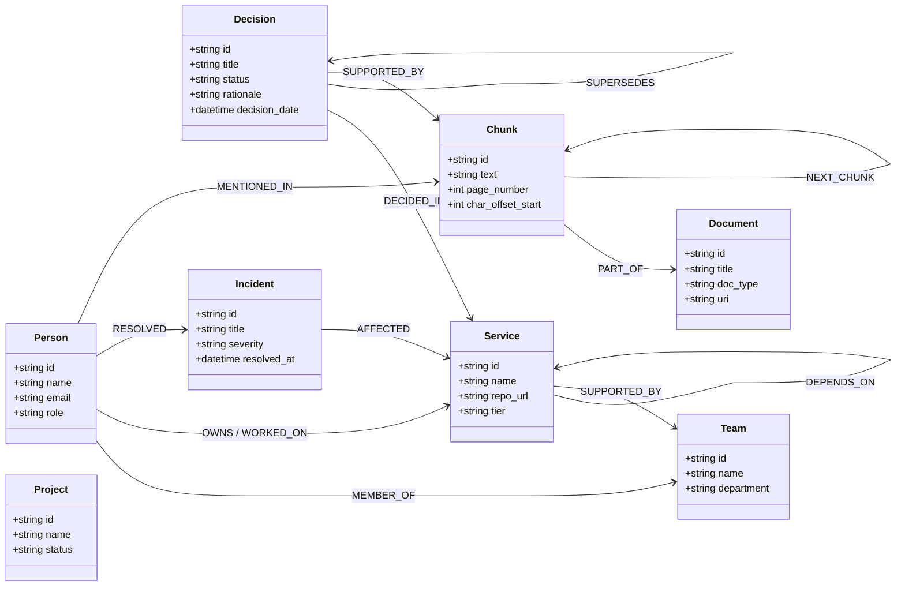

# Module 02 — FalkorDB Connection, Graph Schema, and Cypher Service

## Goal
Build the canonical company knowledge graph schema and high-performance Cypher query service on **FalkorDB**. FalkorDB must serve as the primary operational backbone for organizational reasoning, relationship traversal, decision lineage, and provenance tracking.

---

## 1. Graph Data Model Specification



---

## 2. Canonical Node Specifications

FalkorDB nodes must adhere strictly to these schemas. Unique constraints must be established on `id` for each entity label.

| Node Label | Description | Mandatory Properties | Optional Properties | Unique Constraint & Indexes |
| :--- | :--- | :--- | :--- | :--- |
| `Person` | Employee or contractor | `id` (slug), `name`, `email` | `role`, `department`, `seniority`, `skills` | Constraint on `id`; Index on `name`, `email` |
| `Team` | Organizational engineering team | `id`, `name`, `department` | `slack_channel`, `lead_person_id` | Constraint on `id`; Index on `name` |
| `Project` | Discrete initiative or roadmap milestone | `id`, `name`, `status` | `start_date`, `target_date`, `lead_id` | Constraint on `id`; Index on `name`, `status` |
| `Service` | Microservice, system, or database | `id`, `name`, `tier` | `repo_url`, `language`, `active_version` | Constraint on `id`; Index on `name` |
| `Document` | Ingested source artifact (PDF/MD/DOCX) | `id`, `title`, `source_type`, `uri`, `created_at` | `checksum`, `file_size_bytes`, `mime_type` | Constraint on `id`; Index on `title`, `checksum` |
| `Chunk` | Granular text passage for vector/RAG | `id`, `source_id`, `text`, `chunk_index` | `page_number`, `char_offset_start`, `char_offset_end` | Constraint on `id`; Fulltext/Vector index on `text` |
| `Ticket` | Bug report, Jira ticket, or task | `id`, `title`, `status`, `created_at` | `priority`, `resolution_notes`, `reporter_id` | Constraint on `id`; Index on `id` |
| `ChatMessage` | Slack or Teams thread extract | `id`, `channel`, `timestamp`, `text` | `thread_ts`, `sender_person_id` | Constraint on `id`; Index on `channel`, `timestamp` |
| `Decision` | Architecture Decision Record (ADR) | `id`, `title`, `status`, `decision_date`, `rationale`| `superseded_by_id`, `context`, `consequences` | Constraint on `id`; Index on `status`, `decision_date` |
| `Incident` | Production outage or Sev-1/2 event | `id`, `title`, `severity`, `occurred_at` | `resolved_at`, `root_cause`, `postmortem_url` | Constraint on `id`; Index on `severity`, `occurred_at` |
| `Skill` | Technical competency or domain | `id`, `name`, `category` | `description`, `canonical_keywords` | Constraint on `id`; Index on `name` |

### Universal Entity Metadata Properties
All enterprise entity nodes (`Person`, `Team`, `Service`, `Project`, `Decision`, `Incident`) automatically maintain these standardized properties in FalkorDB:
- `created_at`: ISO-8601 creation timestamp.
- `updated_at`: ISO-8601 last mutation timestamp.
- `last_verified_at`: Timestamp of most recent document re-ingestion or human verification.
- `freshness_score`: Float between `0.0` and `1.0` computed via the 6-factor composite decay formula.
- `connections_count`: Integer tracking total active degree centrality in the knowledge graph.
- `staleness_status`: Enumeration: `"ACTIVE"`, `"STALE_UNVERIFIED"`, or `"SUPERSEDED"`.

---

## 3. Canonical Relationship Specifications

| Relationship Type | Source Entity | Target Entity | Properties | Semantic Meaning |
| :--- | :--- | :--- | :--- | :--- |
| `MEMBER_OF` | `Person` | `Team` | `role`, `joined_date`, `is_lead` | Affirms employee team affiliation |
| `OWNS` | `Person` or `Team` | `Service` or `Project` | `is_primary`, `assigned_at`, `source_id` | Explicit contractual ownership and accountability |
| `WORKED_ON` | `Person` | `Service` or `Project` | `role`, `last_active_at`, `contribution_type` | Historical participation without formal ownership |
| `KNOWS_ABOUT` | `Person` | `Skill` or `Service` | `is_inferred: true`, `confidence: float`, `reason: string` | Estimated subject-matter expertise |
| `DEPENDS_ON` | `Service` | `Service` | `dependency_type` (sync, async, db), `criticality` | Directed dependency edge for blast radius analysis |
| `SUPPORTED_BY` | `Service` | `Team` | `tier`, `on_call_schedule` | Team responsible for 24/7 service maintenance |
| `DECIDED_IN` | `Decision` | `Service` or `Project`| `impact_level` | Architectural decision binding a service |
| `RESOLVED` | `Person` | `Incident` | `lead_resolver: bool`, `resolution_summary` | Record of who mitigated an outage |
| `MENTIONED_IN` | Any Entity | `Chunk` | `frequency: int`, `sentiment` | Provenance link connecting graph entity to raw text |
| `PART_OF` | `Chunk` | `Document` | `index: int`, `section_heading` | Hierarchical chunk-to-document parentage |
| `NEXT_CHUNK` | `Chunk` | `Chunk` | `sequence: int` | Linear reading flow between adjacent chunks |
| `SUPERSEDES` | `Decision` (Newer) | `Decision` (Older) | `superseded_date`, `reason` | Explicit invalidation and replacement of prior decisions |
| `RELATED_TO` | Any Entity | Any Entity | `relationship_note`, `strength: float` | Fallback contextual association |

---

## 4. FalkorDB Connection Service Architecture (`app/graph/connection.py`)

Implement connection lifecycle management and query execution using `falkordb-py`:

```python
import redis
import logging
from falkordb import FalkorDB
from app.core.config import settings

logger = logging.getLogger(__name__)

class FalkorDBService:
    def __init__(self):
        self._driver: FalkorDB | None = None
        self._graph = None

    def connect(self):
        try:
            self._driver = FalkorDB(
                host=settings.FALKORDB_HOST,
                port=settings.FALKORDB_PORT,
                password=settings.FALKORDB_PASSWORD or None
            )
            self._graph = self._driver.select_graph(settings.FALKORDB_GRAPH)
            logger.info(f"Connected to FalkorDB graph '{settings.FALKORDB_GRAPH}' at {settings.FALKORDB_HOST}:{settings.FALKORDB_PORT}")
        except Exception as e:
            logger.error(f"Failed to connect to FalkorDB: {e}")
            raise e

    def query(self, cypher: str, params: dict | None = None):
        """Execute parameterized Cypher query against FalkorDB."""
        if not self._graph:
            self.connect()
        return self._graph.query(cypher, params or {})

    def close(self):
        if self._driver:
            self._driver.connection_pool.disconnect()
            logger.info("FalkorDB connections closed.")
```

---

## 5. Core Parameterized Cypher Templates (`app/graph/queries.py`)

All queries must use strict parameter binding `$params` to prevent injection attacks.

### 1. Idempotent Entity Upsert (`MERGE`)
```cypher
MERGE (s:Service {id: $id})
ON CREATE SET 
    s.name = $name,
    s.tier = $tier,
    s.repo_url = $repo_url,
    s.created_at = datetime($now)
ON MATCH SET 
    s.name = $name,
    s.tier = $tier,
    s.repo_url = $repo_url,
    s.updated_at = datetime($now)
RETURN s.id AS id
```

### 2. Service Ownership Lookup (Explicit vs. Inferred)
```cypher
MATCH (s:Service {id: $service_id})
OPTIONAL MATCH (p_explicit:Person)-[o:OWNS]->(s)
OPTIONAL MATCH (t:Team)-[to:OWNS]->(s)
OPTIONAL MATCH (p_inferred:Person)-[k:KNOWS_ABOUT]->(s)
RETURN 
    s.name AS service_name,
    collect(DISTINCT {id: p_explicit.id, name: p_explicit.name, role: p_explicit.role, type: "explicit_owner"}) AS explicit_owners,
    collect(DISTINCT {id: t.id, name: t.name, department: t.department}) AS owning_teams,
    collect(DISTINCT {id: p_inferred.id, name: p_inferred.name, confidence: k.confidence, reason: k.reason, type: "inferred_expert"}) AS inferred_experts
```

### 3. Recursive Multi-Hop Dependency / Blast Radius Query
```cypher
MATCH path = (root:Service {id: $service_id})-[:DEPENDS_ON*1..5]->(dep:Service)
RETURN 
    root.id AS source_service,
    dep.id AS dependent_service,
    dep.name AS dependent_name,
    dep.tier AS tier,
    length(path) AS depth,
    [node in nodes(path) | node.id] AS traversal_path
ORDER BY depth ASC
```

### 4. Decision Lineage & Supersession Audit
```cypher
MATCH (target:Decision {id: $decision_id})
OPTIONAL MATCH (target)-[:SUPERSEDES*1..4]->(prior:Decision)
OPTIONAL MATCH (newer:Decision)-[:SUPERSEDES*1..4]->(target)
RETURN 
    target.id AS decision_id,
    target.title AS title,
    target.status AS status,
    target.rationale AS rationale,
    target.decision_date AS decision_date,
    collect(DISTINCT {id: prior.id, title: prior.title, status: prior.status, date: prior.decision_date}) AS superseded_prior_decisions,
    collect(DISTINCT {id: newer.id, title: newer.title, status: newer.status, date: newer.decision_date}) AS superseded_by_newer_decisions
```

### 5. Incident Resolutions & Expert Discovery
```cypher
MATCH (s:Service {id: $service_id})<-[:AFFECTED]-(i:Incident)<-[:RESOLVED]-(p:Person)
RETURN 
    i.id AS incident_id,
    i.title AS incident_title,
    i.severity AS severity,
    i.occurred_at AS occurred_at,
    p.id AS resolver_id,
    p.name AS resolver_name,
    p.role AS resolver_role
ORDER BY i.occurred_at DESC
LIMIT 10
```

---

## 6. Schema Initialization & Constraints

On startup, run this initialization script to build indexes:

```cypher
CREATE CONSTRAINT FOR (p:Person) REQUIRE p.id IS UNIQUE;
CREATE CONSTRAINT FOR (s:Service) REQUIRE s.id IS UNIQUE;
CREATE CONSTRAINT FOR (t:Team) REQUIRE t.id IS UNIQUE;
CREATE CONSTRAINT FOR (d:Decision) REQUIRE d.id IS UNIQUE;
CREATE CONSTRAINT FOR (i:Incident) REQUIRE i.id IS UNIQUE;
CREATE CONSTRAINT FOR (doc:Document) REQUIRE doc.id IS UNIQUE;
CREATE CONSTRAINT FOR (c:Chunk) REQUIRE c.id IS UNIQUE;
```

---

## 7. Acceptance Criteria
- [x] FalkorDB connection initializes cleanly and handles reconnections gracefully.
- [x] All 11 node types and 13 relationship types are defined in Pydantic models.
- [x] Unique constraints prevent duplicate entity creation when re-running upsert queries.
- [x] Multi-hop Cypher queries return complete paths without unbounded recursion.
- [x] Decision supersession correctly links older and newer ADRs while retaining prior rationale.
