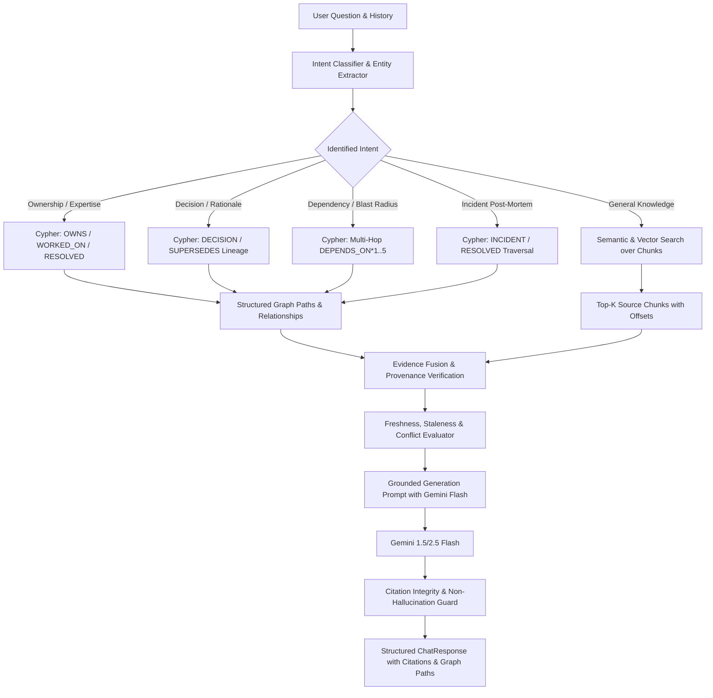

# Module 04 — GraphRAG Retrieval and Company Brain Agent

## Goal
Implement the core multi-hop question answering agent. Answers must be deterministically grounded in FalkorDB graph relationships and verbatim source chunk evidence, not based on unanchored LLM parametric memory.

---

## 1. Multi-Stage Retrieval & Synthesis Architecture



---

## 2. Intent Classification & Routing Matrix

The agent analyzes the user's natural language question and maps it to one of six retrieval strategies:

| Intent Category | Triggers & Examples | FalkorDB Query Target | Secondary Vector Target |
| :--- | :--- | :--- | :--- |
| `OWNERSHIP_EXPERTISE` | *"Who owns Payment Service?", "Who knows about Kafka?"* | `(p:Person)-[:OWNS]->(s:Service)` + `[:WORKED_ON]` | Team charter docs, PR comments |
| `ARCHITECTURE_DECISION` | *"Why did we choose PostgreSQL?", "What is ADR-001?"* | `(d:Decision)-[:DECIDED_IN]->(s)` + `[:SUPERSEDES]` | ADR text chunks, design docs |
| `DEPENDENCY_IMPACT` | *"What breaks if Auth Service is down?", "Blast radius"* | `(s1)-[:DEPENDS_ON*1..5]->(s2)` recursive paths | Architecture diagrams, runbooks |
| `INCIDENT_RESOLUTION` | *"Who solved the payment outage?", "Past incidents"* | `(p)-[:RESOLVED]->(i:Incident)-[:AFFECTED]->(s)` | Post-mortem markdown chunks |
| `FRESHNESS_CONFLICT` | *"Is PostgreSQL still current?", "Contradictions"* | `(d1)-[:SUPERSEDES]->(d2)` + timestamp compare | Recent meeting notes, chats |
| `GENERAL_KNOWLEDGE` | *"What is Northstar Systems?", "Company mission"* | Organization & Team node overviews | Top-5 semantic vector chunks |

---

## 3. Strict Grounding System Prompt (Gemini Flash)

The system prompt enforces strict citation attribution, transparent conflict disclosure, and honest abstention:

```text
You are the Company Brain Organizational Intelligence Agent. Your answers must be 100% faithful to the retrieved graph facts and source excerpts provided below.

Strict Directives:
1. Grounding: Answer ONLY based on the provided Graph Paths and Source Excerpts. Do not hallucinate external facts or extrapolate beyond the provided text.
2. Citation Format: For every factual claim, attach an inline citation tag: [Source: <source_id>, Chunk: <chunk_id>].
3. Ownership Distinction: Explicitly distinguish formal owners (connected via OWNS) from contributors or inferred experts (connected via WORKED_ON or KNOWS_ABOUT).
4. Decision Supersession: If an architectural decision has been superseded, state the current decision first, and explain what previous decision was replaced and why.
5. Contradiction Transparency: If two sources make incompatible claims (e.g. conflicting owners or contradictory dates), do not guess. Clearly highlight the contradiction and cite both sources.
6. Honest Abstention: If the evidence does not contain sufficient information to answer the question, state: "Based on available company records, this cannot be confirmed." Provide follow-up questions if helpful.
```

---

## 4. Response Pydantic Schema (`app/models/chat.py`)

The response payload returned by `POST /api/chat`:

```python
from pydantic import BaseModel, Field
from typing import List, Optional, Literal
from datetime import datetime

class Citation(BaseModel):
    source_id: str = Field(..., description="Unique ID of source document")
    source_title: str = Field(..., description="Human-readable document title")
    source_uri: Optional[str] = Field(None, description="Local or repository URI")
    chunk_id: str = Field(..., description="UUID of the specific chunk")
    page_number: Optional[int] = Field(None, description="Page number if PDF")
    excerpt: str = Field(..., description="Verbatim text supporting the claim")
    timestamp: Optional[datetime] = None

class GraphPath(BaseModel):
    start_node: str
    end_node: str
    relationships: List[str]
    nodes: List[dict]
    description: str

class ChatResponse(BaseModel):
    answer: str = Field(..., description="Synthesized grounded response with inline citation tags")
    citations: List[Citation] = Field(default_factory=list, description="Verified source citations")
    graph_paths: List[GraphPath] = Field(default_factory=list, description="Traversed FalkorDB paths")
    confidence_label: Literal["high", "medium", "low", "insufficient_evidence"]
    warnings: List[str] = Field(default_factory=list, description="Warnings regarding stale or conflicting data")
    follow_up_questions: List[str] = Field(default_factory=list, description="Relevant exploratory questions")
```

---

## 5. End-to-End Chat API Endpoint

### `POST /api/chat`
**Request Payload**:
```json
{
  "question": "Who owns the Payment Gateway service, and what architectural decisions justify its primary database?",
  "conversation_id": "conv-10293",
  "max_hops": 3
}
```

**Response Payload**:
```json
{
  "answer": "The Payment Gateway service is owned by Sarah Chen (Staff Backend Engineer) [Source: doc-northstar-team-charter, Chunk: chk-012]. Its primary database was initially chosen as PostgreSQL under ADR-001 for ACID compliance [Source: doc-adr-001, Chunk: chk-045], but this was later superseded by ADR-004 to use CockroachDB for multi-region active-active replication [Source: doc-adr-004, Chunk: chk-089].",
  "citations": [
    {
      "source_id": "doc-northstar-team-charter",
      "source_title": "Core Payments Team Charter 2026",
      "chunk_id": "chk-012",
      "excerpt": "Sarah Chen acts as Primary Tech Lead and Service Owner for Payment Gateway.",
      "page_number": 2,
      "timestamp": "2026-01-10T09:00:00Z"
    },
    {
      "source_id": "doc-adr-004",
      "source_title": "ADR 004 — Migration to CockroachDB",
      "chunk_id": "chk-089",
      "excerpt": "ADR 004 supersedes ADR 001. Due to international latency requirements, the ledger database is migrated from PostgreSQL to CockroachDB.",
      "page_number": 1,
      "timestamp": "2026-08-20T14:30:00Z"
    }
  ],
  "graph_paths": [
    {
      "start_node": "sarah-chen",
      "end_node": "payment-gateway",
      "relationships": ["OWNS"],
      "nodes": [{"id": "sarah-chen", "label": "Person"}, {"id": "payment-gateway", "label": "Service"}],
      "description": "Sarah Chen explicitly OWNS Payment Gateway"
    },
    {
      "start_node": "adr-004",
      "end_node": "adr-001",
      "relationships": ["SUPERSEDES"],
      "nodes": [{"id": "adr-004", "label": "Decision"}, {"id": "adr-001", "label": "Decision"}],
      "description": "ADR 004 explicitly SUPERSEDES ADR 001"
    }
  ],
  "confidence_label": "high",
  "warnings": [
    "ADR-001 is superseded by ADR-004 as of August 20, 2026."
  ],
  "follow_up_questions": [
    "Would you like to inspect the incident history of Payment Gateway?",
    "Would you like to review downstream services depending on Payment Gateway?"
  ]
}
```

---

## 6. Acceptance Criteria
- [x] Correctly routes questions across all 6 supported intent categories.
- [x] Multi-hop graph traversals correctly populate the `graph_paths` field.
- [x] Every citation refers to an actual `Chunk` and `Document` node stored in FalkorDB.
- [x] If asked an unsupported question without evidence, the agent abstains with `confidence_label: "insufficient_evidence"`.
- [x] Superseded decisions are surfaced with their superseding successors highlighted.
