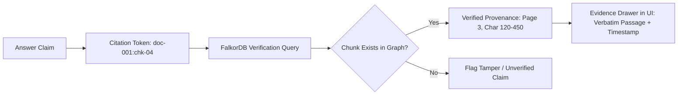
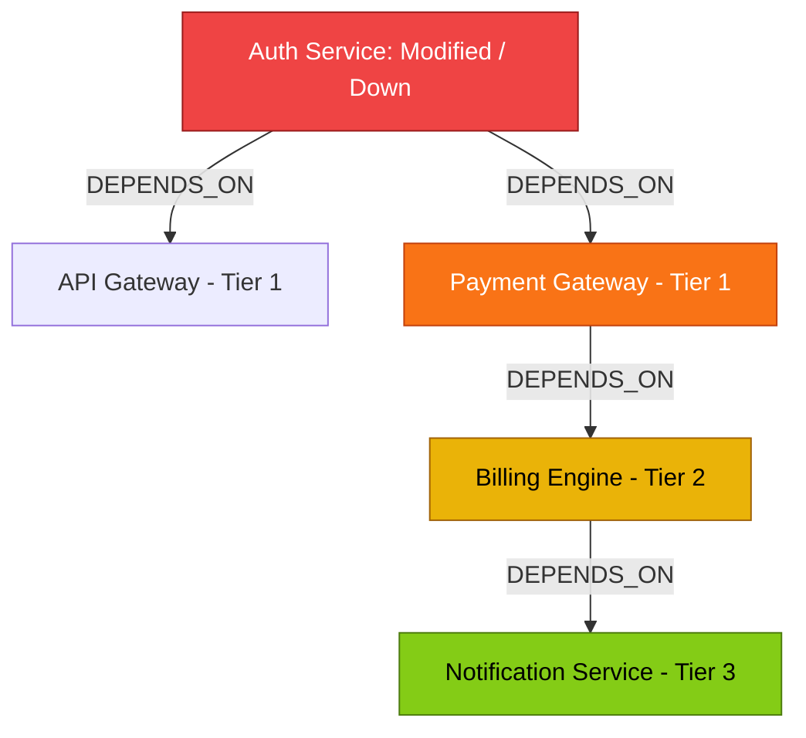

# Module 05 — Evidence, Decision History, Freshness, and Impact Analysis

## Goal
Transform Company Brain into a reliable, self-auditing intelligence platform by implementing deep evidence inspection, decision supersession tracking, staleness detection, contradiction alerts, inferred expertise scoring, and recursive blast radius impact analysis.

---

## 1. Deep Evidence Inspection & "Why This Answer?" Engine

Every answer returned by Company Brain includes an auditable evidence chain that maps natural language claims back to FalkorDB graph nodes and verbatim source chunks.



### Evidence Payload Structure
```json
{
  "claim": "Sarah Chen is the primary owner of Payment Gateway",
  "evidence_type": "EXPLICIT_GRAPH_EDGE",
  "graph_edge": {
    "source": "sarah-chen",
    "relation": "OWNS",
    "target": "payment-gateway",
    "assigned_at": "2026-01-10T09:00:00Z"
  },
  "supporting_chunks": [
    {
      "source_id": "doc-northstar-team-charter",
      "chunk_id": "chk-012",
      "excerpt": "Sarah Chen acts as Primary Tech Lead and Service Owner for Payment Gateway.",
      "page_number": 2,
      "last_verified": "2026-09-15T10:00:00Z"
    }
  ],
  "confidence_score": 1.0
}
```

---

## 2. Decision Lineage & Supersession Mechanics

Architectural Decision Records (ADRs) undergo revisions over time. Company Brain preserves full historical lineage using directed `[:SUPERSEDES]` relationships.

```mermaid
graph LR
    ADR001["ADR-001: PostgreSQL (Status: SUPERSEDED, Date: Jan 2025)"] 
    ADR004["ADR-004: CockroachDB (Status: ACTIVE, Date: Aug 2026)"]
    
    ADR004 -->|SUPERSEDES {reason: 'Multi-region replication'}| ADR001
    
    style ADR004 fill:#059669,stroke:#047857,color:#fff
    style ADR001 fill:#dc2626,stroke:#b91c1c,color:#fff
```

### Lineage Cypher Query
```cypher
MATCH (d:Decision {id: $decision_id})
OPTIONAL MATCH (d)-[r:SUPERSEDES*1..5]->(ancestor:Decision)
OPTIONAL MATCH (newer:Decision)-[:SUPERSEDES*1..5]->(d)
RETURN 
    d.id AS current_id,
    d.title AS title,
    d.status AS status,
    d.rationale AS rationale,
    [n in collect(DISTINCT ancestor) | {id: n.id, title: n.title, status: n.status, date: n.decision_date}] AS superseded_ancestors,
    [n in collect(DISTINCT newer) | {id: n.id, title: n.title, status: n.status, date: n.decision_date}] AS superseded_by_descendants
```

---

## 3. 6-Factor Composite Memory & Freshness Decay Scoring

To ensure organizational knowledge remains reliable over time, Company Brain implements an automated **Memory & Freshness Decay System** scheduled to evaluate the graph periodically (e.g., via background worker or `POST /api/sync`).

### The 6-Factor Composite Formula

$$\text{Freshness}(n) = \left( w_1 f_{\text{age}} + w_2 f_{\text{recency}} + w_3 f_{\text{auth}} + w_4 f_{\text{conn}} \right) \times p_{\text{super}} \times p_{\text{conf}}$$

| Factor | Name | Metric / Calculation | Weight |
| :---: | :--- | :--- | :---: |
| **$f_1$** | **Temporal Age ($f_{\text{age}}$)** | Exponential half-life decay based on creation date: $e^{-\lambda \cdot \Delta t_{\text{created}}}$ | 0.25 |
| **$f_2$** | **Verification Recency ($f_{\text{recency}}$)** | Boost based on elapsed time since last sync or verification check: $e^{-\mu \cdot \Delta t_{\text{verified}}}$ | 0.30 |
| **$f_3$** | **Source Authority ($f_{\text{auth}}$)** | Tiered authority score: ADR/Charter = 1.0, Tech Spec = 0.85, Post-Mortem = 0.75, Chat/Ticket = 0.50 | 0.25 |
| **$f_4$** | **Graph Centrality ($f_{\text{conn}}$)** | Degree centrality normalized by total active neighborhood edges in FalkorDB | 0.20 |
| **$p_1$** | **Supersession Penalty ($p_{\text{super}}$)** | Multiplier: 1.0 if `ACTIVE`; drops to **0.15** if superseded by a newer decision | Multiplier |
| **$p_2$** | **Contradiction Penalty ($p_{\text{conf}}$)** | Multiplier: 1.0 if uncontested; drops to **0.60** if active conflicting claims exist | Multiplier |

### Classification Tiers
- **Score $\ge 0.80$ (`ACTIVE`)**: Fully fresh, verified, and authoritative. Displayed with emerald badge.
- **$0.40 \le \text{Score} < 0.80$ (`STALE_UNVERIFIED`)**: Aged knowledge requiring verification. Displayed with amber badge and staleness warning.
- **Score $< 0.40$ (`SUPERSEDED` / `DISPUTED`)**: Inactive or superseded knowledge. Displayed with red badge and direct link to superseding record.

### Synchronization & Decay API (`POST /api/sync`)
- Compares SHA-256 hashes of sample corpus files against FalkorDB `Document.checksum`.
- Recalculates 6-factor composite freshness scores for all graph entities.
- Flags outdated nodes without deleting historical audit paths.

---

## 4. Conflicting Knowledge Detection & Transparent Surfacing

When two ingested documents provide contradictory facts (e.g., Document A states Dave is owner; Document B states Sarah is owner), Company Brain does not pick a winner silently.

### Conflict Detection Algorithm
```python
def evaluate_ownership_conflict(service_id: str, graph_service):
    query = """
    MATCH (s:Service {id: $service_id})<-[o:OWNS]-(p:Person)
    RETURN p.id AS person_id, p.name AS name, o.assigned_at AS assigned_at, o.source_id AS source_id
    """
    records = graph_service.query(query, {"service_id": service_id})
    if len(records) > 1:
        return {
            "has_conflict": True,
            "warning": f"Conflicting ownership records detected for service '{service_id}'.",
            "candidates": records,
            "resolution_policy": "Human confirmation required; displaying latest dated record first."
        }
    return {"has_conflict": False}
```

---

## 5. Inferred Expertise Scoring

Company Brain distinguishes explicit contractual ownership (`OWNS`) from inferred domain expertise (`KNOWS_ABOUT`).

### Scoring Heuristic
$$\text{Expertise Score} = \min\left(1.0, 0.4 \cdot N_{\text{incidents}} + 0.3 \cdot N_{\text{ADRs}} + 0.2 \cdot N_{\text{tickets}} + 0.1 \cdot N_{\text{skills}}\right)$$

### Cypher Materialization of Inferred Expertise
```cypher
MATCH (p:Person)-[:RESOLVED]->(i:Incident)-[:AFFECTED]->(s:Service {id: $service_id})
WITH p, count(i) AS incident_count
MATCH (p)-[:MEMBER_OF]->(t:Team)
MERGE (p)-[k:KNOWS_ABOUT]->(s)
SET 
    k.confidence = 0.5 + (incident_count * 0.15),
    k.reason = "Resolved " + toString(incident_count) + " critical incidents affecting this service",
    k.is_inferred = true,
    k.updated_at = datetime()
RETURN p.name, k.confidence, k.reason
```

---

## 6. Recursive Blast Radius & Dependency Impact Analysis

Calculates all downstream services and teams affected when a service changes or experiences downtime.



### Impact Analysis Endpoint: `GET /api/projects/{project_id}/impact`
**Query Parameters**: `depth=5` (traversal depth limit)

**Response Schema**:
```json
{
  "target_service": "auth-service",
  "blast_radius_score": "CRITICAL",
  "total_affected_services": 4,
  "highest_affected_tier": "Tier 1",
  "affected_nodes": [
    {
      "service_id": "api-gateway",
      "service_name": "API Gateway",
      "tier": "Tier 1",
      "hop_distance": 1,
      "dependency_type": "synchronous_grpc",
      "owning_team": "Platform Engineering"
    },
    {
      "service_id": "payment-gateway",
      "service_name": "Payment Gateway",
      "tier": "Tier 1",
      "hop_distance": 1,
      "dependency_type": "synchronous_rest",
      "owning_team": "Core Payments"
    },
    {
      "service_id": "billing-engine",
      "service_name": "Billing Engine",
      "tier": "Tier 2",
      "hop_distance": 2,
      "dependency_type": "async_kafka",
      "owning_team": "Core Payments"
    }
  ]
}
```

---

## 7. Acceptance Criteria
- [x] Superseded decisions retain their previous rationale and are queryable via `SUPERSEDES` paths.
- [x] Contradictory sources trigger an explicit warning banner and present both source citations.
- [x] Inferred expertise is clearly distinguished from formal ownership with supporting reasons.
- [x] Recursive impact traversal identifies all downstream dependencies up to 5 hops with tier classification.
- [x] `POST /api/sync` runs idempotently and updates modified sources without creating orphan nodes.
