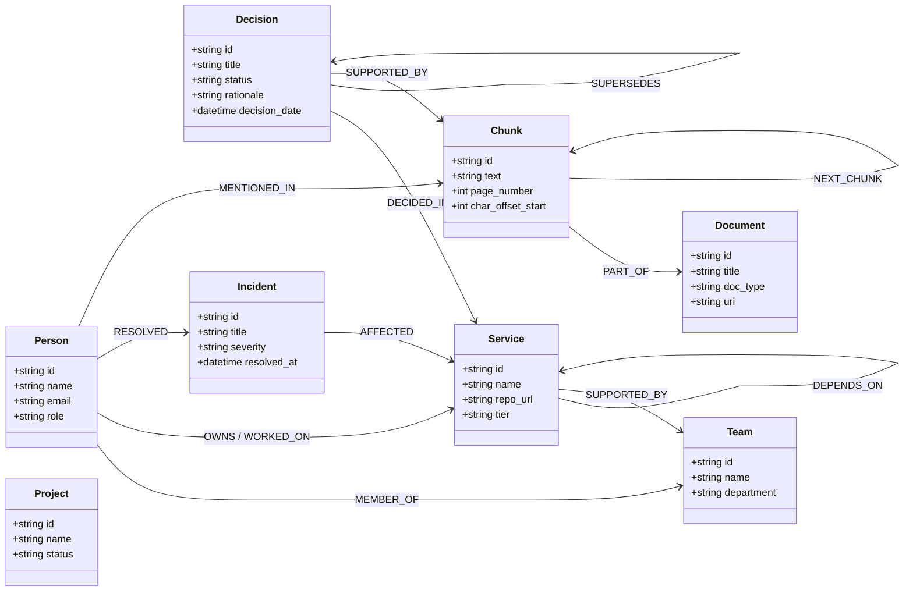

# Graph Data Model & Schema — Company Brain

## 1. Graph Entity Model Overview

Company Brain represents organizational knowledge as a deterministic property graph stored inside **FalkorDB**. The schema captures formal ownership, inferred subject matter expertise, multi-hop architectural dependencies, and temporal decision supersession.



---

## 2. Canonical Node Specifications (11 Entities)

All entity nodes maintain universal metadata:
- `created_at`: ISO-8601 creation timestamp
- `updated_at`: ISO-8601 last mutation timestamp
- `last_verified_at`: Timestamp of most recent document re-ingestion or verification
- `freshness_score`: Float between `0.0` (stale) and `1.0` (fresh)
- `connections_count`: Total active relationships in the knowledge graph
- `staleness_status`: `ACTIVE`, `STALE_UNVERIFIED`, or `SUPERSEDED`

| Node Label | Description | Mandatory Properties | Optional Properties | Indexes & Constraints |
| :--- | :--- | :--- | :--- | :--- |
| `Person` | Employee or contractor | `id` (slug), `name`, `email` | `role`, `department`, `seniority`, `skills` | Unique constraint on `id`; Range index on `name`, `email` |
| `Team` | Organizational engineering team | `id`, `name`, `department` | `slack_channel`, `lead_person_id` | Unique constraint on `id`; Range index on `name` |
| `Project` | Discrete initiative or roadmap milestone | `id`, `name`, `status` | `start_date`, `target_date`, `lead_id` | Unique constraint on `id`; Range index on `name` |
| `Service` | Microservice, system, or database | `id`, `name`, `tier` | `repo_url`, `language`, `active_version` | Unique constraint on `id`; Range index on `name` |
| `Document` | Ingested source artifact (PDF/MD/DOCX) | `id`, `title`, `source_type` | `uri`, `checksum`, `file_size_bytes`, `mime_type` | Unique constraint on `id`; Range index on `checksum` |
| `Chunk` | Granular text passage for vector/RAG | `id`, `source_id`, `text`, `chunk_index` | `page_number`, `char_offset_start`, `char_offset_end` | Unique constraint on `id` |
| `Ticket` | Bug report, Jira ticket, or task | `id`, `title`, `status` | `priority`, `resolution_notes`, `reporter_id` | Unique constraint on `id` |
| `ChatMessage` | Slack or Teams thread extract | `id`, `channel`, `timestamp`, `text` | `thread_ts`, `sender_person_id` | Unique constraint on `id` |
| `Decision` | Architecture Decision Record (ADR) | `id`, `title`, `status`, `rationale` | `decision_date`, `superseded_by_id`, `context`, `consequences` | Unique constraint on `id`; Range index on `status`, `decision_date` |
| `Incident` | Production outage or Sev-1/2 event | `id`, `title`, `severity`, `occurred_at` | `resolved_at`, `root_cause`, `postmortem_url` | Unique constraint on `id`; Range index on `severity`, `occurred_at` |
| `Skill` | Technical competency or domain | `id`, `name`, `category` | `description`, `canonical_keywords` | Unique constraint on `id` |

---

## 3. Canonical Relationship Specifications (13 Types)

| Relationship Type | Source Entity | Target Entity | Properties | Semantic Meaning |
| :--- | :--- | :--- | :--- | :--- |
| `MEMBER_OF` | `Person` | `Team` | `role`, `joined_date`, `is_lead` | Employee team affiliation |
| `OWNS` | `Person` or `Team` | `Service` or `Project` | `is_primary`, `assigned_at`, `source_id` | Explicit contractual accountability |
| `WORKED_ON` | `Person` | `Service` or `Project` | `role`, `last_active_at`, `contribution_type` | Historical contribution without ownership |
| `KNOWS_ABOUT` | `Person` | `Skill` or `Service` | `is_inferred: true`, `confidence: float`, `reason: str` | Inferred subject-matter expertise |
| `DEPENDS_ON` | `Service` | `Service` | `dependency_type`, `criticality` | Directed dependency edge for blast radius analysis |
| `SUPPORTED_BY` | `Service` | `Team` | `tier`, `on_call_schedule` | Team maintaining service in production |
| `DECIDED_IN` | `Decision` | `Service` or `Project` | `impact_level` | Architectural decision binding a service |
| `RESOLVED` | `Person` | `Incident` | `lead_resolver: bool`, `resolution_summary` | Record of engineer mitigating an outage |
| `MENTIONED_IN` | Any Entity | `Chunk` | `frequency: int`, `sentiment` | Provenance link connecting graph entity to raw text |
| `PART_OF` | `Chunk` | `Document` | `index: int`, `section_heading` | Chunk-to-document parentage |
| `NEXT_CHUNK` | `Chunk` | `Chunk` | `sequence: int` | Linear reading flow between adjacent passages |
| `SUPERSEDES` | `Decision` (Newer) | `Decision` (Older) | `superseded_date`, `reason` | Invalidation and replacement of prior decisions |
| `RELATED_TO` | Any Entity | Any Entity | `relationship_note`, `strength: float` | General associative fallback relationship |

---

## 4. Parameterized Cypher Query Operations

### 1. Service Ownership & Inferred Expertise
```cypher
MATCH (s:Service {id: $service_id})
OPTIONAL MATCH (p_explicit:Person)-[:OWNS]->(s)
OPTIONAL MATCH (t:Team)-[:OWNS]->(s)
OPTIONAL MATCH (p_inferred:Person)-[k:KNOWS_ABOUT]->(s)
RETURN 
    s.id AS service_id,
    s.name AS service_name,
    s.tier AS tier,
    [p in collect(DISTINCT p_explicit) WHERE p IS NOT NULL | {id: p.id, name: p.name, role: p.role, type: "explicit_owner"}] AS explicit_owners,
    [tm in collect(DISTINCT t) WHERE tm IS NOT NULL | {id: tm.id, name: tm.name, department: tm.department}] AS owning_teams,
    [pi in collect(DISTINCT p_inferred) WHERE pi IS NOT NULL | {id: pi.id, name: pi.name, role: pi.role, confidence: pi.confidence, reason: pi.reason, type: "inferred_expert"}] AS inferred_experts
```

### 2. Multi-Hop Dependency Blast Radius Traversal
```cypher
MATCH path = (root:Service {id: $service_id})-[:DEPENDS_ON*1..5]->(dep:Service)
RETURN 
    root.id AS source_service,
    dep.id AS dependent_service,
    dep.name AS dependent_name,
    dep.tier AS tier,
    length(path) AS depth,
    [node in nodes(path) | node.id] AS traversal_path
ORDER BY depth ASC
```

### 3. Decision Lineage & Supersession Audit
```cypher
MATCH (target:Decision {id: $decision_id})
OPTIONAL MATCH (target)-[:SUPERSEDES*1..4]->(prior:Decision)
OPTIONAL MATCH (newer:Decision)-[:SUPERSEDES*1..4]->(target)
RETURN 
    target.id AS decision_id,
    target.title AS title,
    target.status AS status,
    target.rationale AS rationale,
    target.decision_date AS decision_date,
    [p in collect(DISTINCT prior) WHERE p IS NOT NULL | {id: p.id, title: p.title, status: p.status, date: p.decision_date}] AS superseded_prior_decisions,
    [n in collect(DISTINCT newer) WHERE n IS NOT NULL | {id: n.id, title: n.title, status: n.status, date: n.decision_date}] AS superseded_by_newer_decisions
```

### 4. Incident Resolutions & Expert Discovery
```cypher
MATCH (s:Service {id: $service_id})<-[:AFFECTED]-(i:Incident)<-[:RESOLVED]-(p:Person)
RETURN 
    i.id AS incident_id,
    i.title AS incident_title,
    i.severity AS severity,
    i.occurred_at AS occurred_at,
    p.id AS resolver_id,
    p.name AS resolver_name,
    p.role AS resolver_role
ORDER BY i.occurred_at DESC
LIMIT $limit
```
